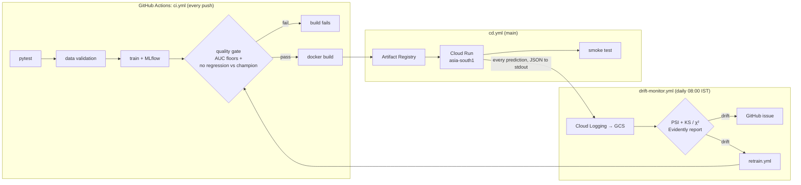

# End-to-end MLOps pipeline: churn prediction from commit to cloud, with drift monitoring

**Author:** [Sharbesh S](https://github.com/SharbeshS8199) · MIT License

The model is deliberately simple (a gradient-boosted churn classifier on the Telco customer
schema). **The point is everything around it:** every training run is tracked, a quality gate
stops worse models from shipping, CI/CD deploys to Google Cloud Run, every prediction is logged,
and a daily drift check opens an issue and retrains automatically when production data shifts.



## Dashboard

```bash
pip install -e '.[dashboard]'      # streamlit + plotly
streamlit run dashboard/app.py
```

Champion model and quality-gate status · sidebar buttons to **send normal or drifted traffic** and **retrain with the gate** · per-feature drift (PSI) with training-vs-production distributions · live prediction volume and score distribution · Prometheus metrics · every tracked run, coloured by gate result.

## What each piece shows

| Piece | Where | Why it matters |
|---|---|---|
| Experiment tracking | `churn/tracking.py`: MLflow (params, metrics, model, registry), or a JSON fallback | Every number is reproducible and tied to a run ID and code version |
| Data validation gate | `churn/validate.py`: schema, ranges, nulls, allowed values, label rate | Bad data fails the build before it can train a bad model |
| Quality gate + promotion | `churn/train.py`: minimum ROC/PR-AUC, and **no regression vs the current champion** | Only a model that passed the gate can reach production |
| CI | `.github/workflows/ci.yml`: tests → validate → train → gate → in-process API test → image | One push runs the whole pipeline |
| CD | `cd.yml`: Workload Identity Federation (no JSON keys), Artifact Registry, Cloud Run, live smoke test | Secure, repeatable deploys |
| Serving | `app/main.py` + `churn/serving.py`: FastAPI with validated inputs, `/health` (model version and metrics), Prometheus `/metrics`, prediction logging | Observable in production |
| Drift monitoring | `churn/drift.py` + `drift-monitor.yml`: PSI with KS / χ² per feature, Evidently HTML report, Markdown summary in a GitHub issue | Catches silent model decay |
| Closed loop | `retrain.yml`: pulls fresh labelled data, same validation and gate, republishes, redeploys | Retraining is automatic, but never ships a worse model |

## Run the whole loop locally (about 1 minute, no cloud account needed)

```bash
pip install -e '.[api,dev]'
make drift-demo
```

Output from this repo's own run:

```
data validation: passed
{"roc_auc": 0.8145, "pr_auc": 0.6174, "f1_at_0.5": 0.5683, "brier": 0.1529}
gate passed -> promoted run 6d4431cdc23f to champion

sent 2000 requests                                    # a normal week
drifted features: 0%  dataset drift: False

sent 2000 drifted requests                            # price rise + more fibre and e-cheque customers
drifted features: 12%  dataset drift: True
  MonthlyCharges     PSI 1.285  p=1.4e-125  DRIFT
  InternetService    PSI 0.118  p=4.9e-26   DRIFT
  PaymentMethod      PSI 0.069  p=7.8e-15
-> exit code 2: in GitHub Actions this opens an issue and triggers retrain.yml
```

Then try:
- `make serve`, open http://localhost:8000/docs, and call `/predict` and `/metrics`
- `pip install mlflow && make up` to start the MLflow UI at http://localhost:5000 alongside the API
- `pytest`: 6 tests, including "a deliberately worse model is blocked by the gate"

## Deploy to Google Cloud

Follow [`deploy/GCP.md`](deploy/GCP.md) (about 20 minutes, one time): enable the APIs, create the
registry, bucket and Workload Identity Federation, then set four GitHub repository variables. After
that, every push to `main` is tested, gated and deployed, and drift is checked daily. The same
container runs on AWS App Runner; the guide lists the swaps.

## Data

The pipeline uses the IBM **Telco Customer Churn** schema. Put Kaggle's
`WA_Fn-UseC_-Telco-Customer-Churn.csv` in `data/` to train on the real 7,043 customers. Without it,
`churn/data.py` generates data with the same columns. Its `drift=True` mode simulates a later
period with a price rise and a shift in customer mix, which is what the monitor is tested against.

## Layout

```
src/churn/   data.py  validate.py  train.py  tracking.py  serving.py  drift.py  simulate_traffic.py
app/main.py  FastAPI
.github/workflows/  ci.yml  cd.yml  drift-monitor.yml  retrain.yml
deploy/GCP.md  Dockerfile  docker-compose.yml (MLflow + API)  params.yaml  Makefile  tests/
```
